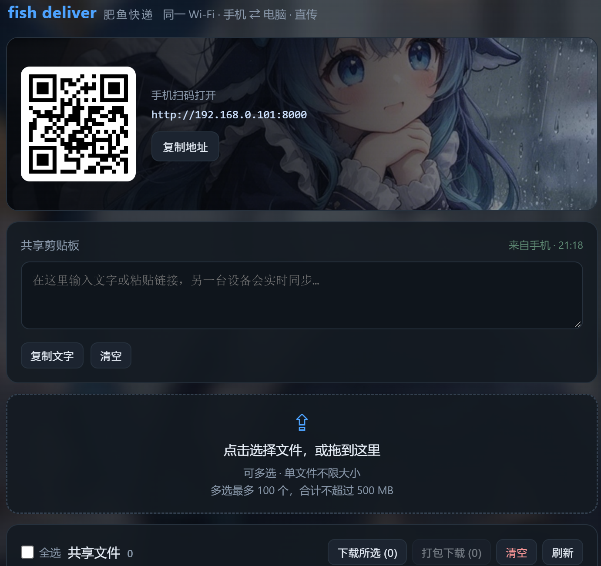

# fish deliver · 肥鱼快递

> 同一 Wi-Fi 下，手机 ⇄ 电脑互传文件的小网页。单文件服务、零第三方依赖、无广告、不走外网。



## 这是什么

电脑上跑一个 Python 脚本，它会在本机开一个网页服务；手机连同一个 Wi-Fi，扫码就能打开。

- **手机 → 电脑**：选文件、拖文件、直接粘贴，传完就落在电脑硬盘上
- **电脑 → 手机**：在手机浏览器里勾选文件下载，或把多个文件打成一个 zip 一次拿走
- **顺手传文字**：共享剪贴板，链接、验证码、一段话，两边约 1.5 秒同步

全程只在局域网里跑，文件不经过任何云端，也不需要注册账号。

## 特性

- **扫码即用**：启动后页面自带二维码和局域网地址，手机扫一下就行，不用手输 IP
- **大文件友好**：单文件不限大小，分块写入；多选一次最多 100 个、合计 500 MB
- **三种上传方式**：点击选择、拖拽到页面、直接 `Ctrl+V` 粘贴文件
- **打包下载**：勾选多个文件，一键打成一个 zip；也可以逐个下载
- **共享剪贴板**：电脑和手机之间互传文字和链接，自动同步，另一台设备上能直接复制
- **零依赖**：只用 Python 标准库，`pip install` 都不需要
- **手机 / 电脑都好看**：响应式布局 + 深色玻璃拟态界面，手机竖屏也不挤
- **不覆盖文件**：同名文件自动变成 `报告 (1).pdf`，不会悄悄盖掉旧文件

## 快速开始

### 1. 准备 Python

需要 **Python 3.8 或更高**。Windows 上装好 Python 后一般自带 `py` 启动器；macOS / Linux 用 `python3`。

### 2. 获取代码

```bash
git clone https://github.com/himoew/fish-deliver.git
cd fish-deliver
```

或者直接在 GitHub 页面点 **Code → Download ZIP** 解压。注意：`fish-deliver-bg.jpg`、`fish-deliver-hero.jpg`、`fish-deliver-icon.ico` 必须和 `lan-drop.py` **放在同一层目录**，界面背景和图标才正常。

### 3. 运行

Windows：双击 `start.bat`，或在当前目录执行：

```bat
py lan-drop.py
```

macOS / Linux：

```bash
python3 lan-drop.py
```

启动后终端会打印这样的地址，电脑浏览器也会自动打开：

```
  fish deliver · 肥鱼快递 已启动
  共享目录  D:\LanDrop

  手机浏览器打开下面地址（或扫电脑屏幕上的二维码）：
    http://192.168.0.101:8000
```

### 4. 手机打开

手机连上**同一个 Wi-Fi**，扫电脑页面上的二维码，或手动输入终端里那串 `http://192.168.x.x:8000`。

> 第一次运行 Windows 会弹防火墙提示，勾选「专用网络」并点**允许访问**。这一步不点，手机就会一直转圈打不开。

## 命令行参数

| 参数 | 说明 | 默认值 |
| --- | --- | --- |
| `--port` | 监听端口 | `8000` |
| `--dir` | 共享目录（上传落盘、下载读取的地方） | `D:\LanDrop` |
| `--no-browser` | 启动时不自动打开电脑浏览器 | 关闭 |

示例：

```bat
py lan-drop.py --port 9000
py lan-drop.py --dir E:\Share --no-browser
```

端口被占用时，会自动在 `--port` 之后的 20 个端口里找空闲的，不用手动改。

## 文件存在哪

- 默认共享目录是 `D:\LanDrop`（没有 D 盘就用 `下载\LanDrop`），可以用 `--dir` 换成任意目录
- 上传的文件、下载列表里看到的文件，都是这个目录里**真实的文件**，可以直接在资源管理器里打开
- 页面上的「清空」会把共享目录里的文件删掉（隐藏文件除外），删之前想清楚
- 共享剪贴板的文字存在共享目录里的隐藏文件 `.shared-text.json`

## 常见问题

**手机打不开，电脑自己能打开？**

按顺序排查：

1. 手机和电脑是不是同一个 Wi-Fi（有些路由器 2.4G / 5G 是两张网，但通常仍互通）
2. Windows 防火墙弹窗有没有点「允许访问」；错过了就去「Windows 安全中心 → 防火墙 → 允许应用通过防火墙」里把 Python 勾上
3. 路由器是否开了「AP 隔离」或「访客网络」——开了的话设备之间互相看不见
4. 公司 / 学校网络常做客户端隔离，这种情况只能换手机热点试试

**敲 `python` 毫无反应，或者弹出应用商店？**

那是 Windows 的应用商店别名占位。改用 `py lan-drop.py`，或用解释器完整路径，例如 `D:\python\python.exe lan-drop.py`。

**上传到一半失败了？**

网络断了或者手机关屏了。重新传一次即可，同名文件会自动改名，不会覆盖之前半截的。

**能在公网 / 外网用吗？**

不建议。它是给「同一个 Wi-Fi」设计的：服务没有登录鉴权，同一局域网内谁打开这个地址都能看到共享目录。别在路由器上做端口映射，公共 Wi-Fi 下别开。

**为什么不用微信 / QQ 传？**

小文件当然可以。但几百 MB 的视频、整个文件夹、或者只想在手机和电脑之间挪一段文字时，本地直传更快，也没有压缩和「文件已过期」。

## 目录结构

```
lan-drop.py             服务端 + 内嵌页面（单文件，约 3700 行）
fish-deliver-bg.jpg     页面背景
fish-deliver-hero.jpg   二维码卡片的背景图
fish-deliver-icon.ico   站点图标（也可用作桌面快捷方式图标）
start.bat               Windows 双击启动
docs/preview.png        README 里的界面截图
LICENSE                 MIT
```

## 实现说明

- 用标准库 `ThreadingHTTPServer` 起服务，HTTP/1.1，256 KB 分块读写，大文件不会一次性读进内存
- 页面 HTML / CSS / JS 全部内嵌在 `lan-drop.py` 里，外部文件只有三张图片
- 二维码由内嵌的 `qrcode.js` 在浏览器本地生成（Kazuhiko Arase，MIT 许可），不请求任何第三方接口
- 上传用 `XMLHttpRequest` 带进度条；文件名会过滤路径穿越、Windows 非法字符和 `CON`/`NUL` 等保留名
- 文件列表每 3 秒、剪贴板每 1.5 秒轮询一次，切换标签页时暂停

## 许可

[MIT](LICENSE)。内嵌的二维码生成器版权归 [Kazuhiko Arase](http://www.d-project.com/)，同样以 MIT 许可分发。

---

当前版本 **1.7**
